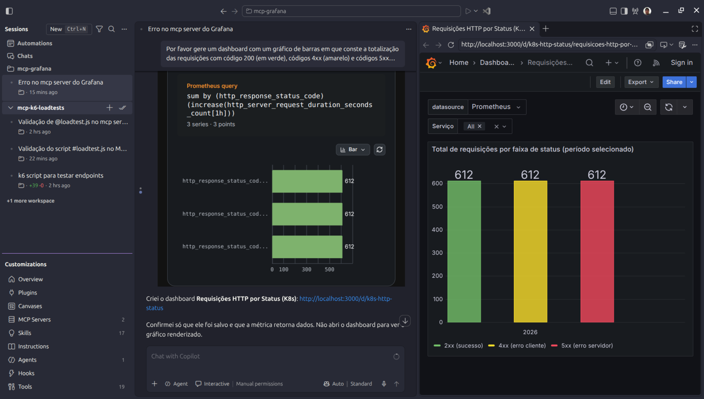
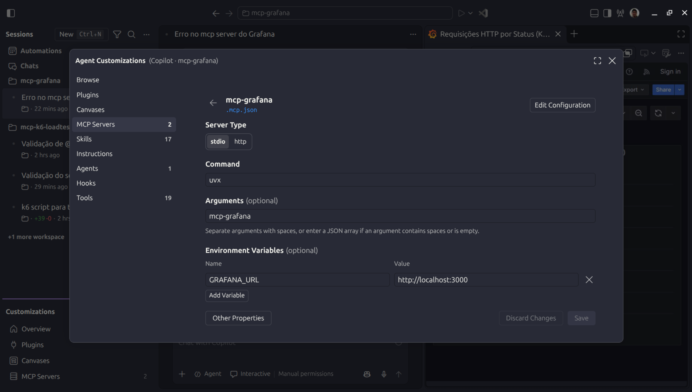

# grafana-mcpserver-uvx-vscode-agents_apicontagem
Configurações para uso do MCP Server do Grafana com uvx (packages Pythons) + Visual Studio Code + GitHub Copilot + Agents Windows. Testes realizados com API REST criada com o .NET 10 + ambiente gerado via Docker Compose (Tempo + Loki + Prometheus + Alloy + OpenTelemetry).

## Testes

Arquivo **.mcp.json**:

```json
{
	"mcpServers": {
		"mcp-grafana": {
			"type": "stdio",
			"command": "uvx",
			"args": [
				"mcp-grafana"
			],
			"env": {
				"GRAFANA_URL": "http://localhost:3000"
			}
		}
	}
}
```

Testes com **Agents window** no **Visual Studio Code** (**Menu View > Command Palette... > Chat: Open Agents Windows**):



Configurações do MCP Server em **Agents windows**:


